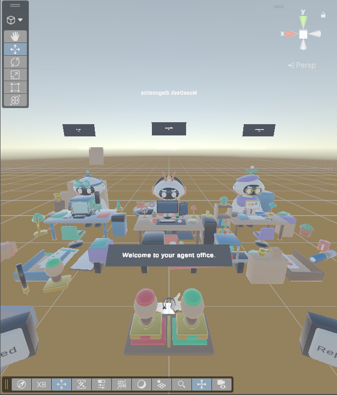
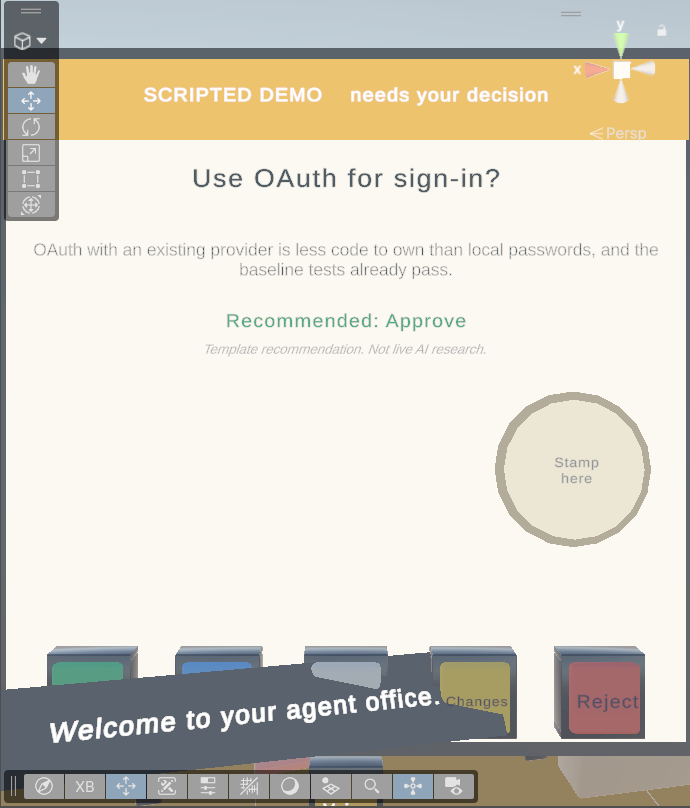
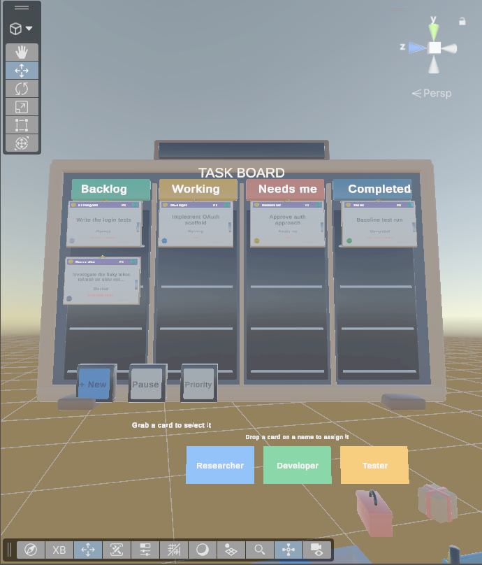

# MuseDesk: project state for expert review (second pass)

Written 2026-11-12, late evening. This supersedes `PROJECT_SUMMARY_FOR_REVIEW.md` (the document the first review was based on). Screenshots are in `docs/review_screenshots/state_2026-11-12_night/`.

Branch `antigravity/visual-polish`, commit `c25286b`. The build from that commit is installed on the Quest 3.

## 1. What it is

A Meta Quest 3 mixed-reality app for supervising AI agents. Three small robot coworkers (Researcher, Developer, Tester) work at miniature desks about 60 cm in front of a seated user, in passthrough. When one needs a human decision it walks over holding a paper. The user takes the paper, reads it, and approves, rejects or asks for changes, by pressing a key or by pressing a physical stamp on the paper. The backend then continues, revises, or stops the work.

Target: Meta VR Start Developer Competition 2026 (Productivity / Best Agentic Interaction). **Deadline 2026-11-18, noon Pacific.** Five and a half days remain. One developer plus AI coding agents (two different agent tools have been working in the same tree).

Two rules the project is built around:

1. **Scripted activity is never presented as live work.** Every event, card, paper and artifact carries and shows `live` or `demo`.
2. **The backend decides.** The interface shows an outcome only after the backend confirms it.

Judges have no access to the developer's PC, so the APK must run a complete, clearly labelled scripted demo on its own.

*Editor capture from the seated eye point (not a headset screenshot; passthrough replaces the ground). Agents face the user; status signs above them; the factory line in front of the desks; a guide sign; the two stamps on a rest pad nearest the user. The task board is out of frame to the left, the Start / Replay / Focus keys to the right. Some small text is not drawn in Editor captures.*

## 2. What changed since the first review

The first review's main criticisms, and where each stands now:

| Criticism | Now | Evidence |
|---|---|---|
| The task board manages cards, not work | One card type ("Build the login flow", template `auth_demo`) launches the real pipeline when assigned to the Researcher. The card follows the run to Completed and the real diff and test report attach to it. Other cards are labelled "Planned" | 145 backend tests; live server run, 71 of 71 checks |
| The Researcher's recommendation is hard-coded but labelled live | Still a template (no model anywhere), now labelled on the event, the paper and the archive: "Template recommendation. Not live AI research." Developer and tester output is separately marked `work_provenance: sandbox_execution` | Same |
| No revision loop | "Changes" produces a revised (template) recommendation and a new decision in the same run, up to two revisions, then the run stops honestly. A failed test run gets one developer retry and a real re-run | Live server run: revised decision, bounded cancel. The retry path is unit-tested only (3 tests) |
| Standalone demo thinner than live | Starts immediately; Start and Replay keys; seeded board; labelled sample diff and test report that open and page offline; reject shows no success | 108 Unity runtime checks |
| Decision paper legibility | Rebuilt (section 4) | Editor capture |
| Hands pass through things | Desk props are pushable and grabbable; agents lean and their arms nudge; keys depress; rendered fingers are meant to stop on graspable surfaces (new, unverified) | None on head |
| Performance unmeasured | **Still unmeasured.** Renderer count was cut (workstations and board frame 206 to 68; each key from six renderers to two) | Static only |
| Verification is mostly automated | Still true. See section 6 | |

Also new since the first review: assign dock under the board, hover feedback on grabbables, drop-zone halos, first-use guide sign, decision archive ("Filed" key), touch-an-agent summary card, voice enabled on the paper, distance grab on cards, paper and stamps.

One correction to the first summary: it described state-driven mascot animation as working. It was not. The animator in the scene had only a walk-speed parameter, and the code set parameters that did not exist, so the agents had only ever played their idle clip. That is fixed in code (a clip per state, gaze, breathing) and unverified on head.

## 3. Architecture (unchanged in shape)

| Part | Technology | Size |
|---|---|---|
| Quest client | Unity 6000.6.8f1, URP, Meta XR SDK 209 (Interaction SDK hands, passthrough), OpenXR, Vulkan, IL2CPP ARM64. One scene | About 13,600 lines of C#, 80 runtime scripts |
| Backend | Python, FastAPI, SQLite, WebSocket | About 4,400 lines, plus 2,400 lines of tests |
| Art | Blender-generated FBX: three rigged characters (39 clips each), workstations, factory, board, props, keycaps, stamps | |
| Tooling | About 160 Editor builder scripts; scene changes are scripted and idempotent | |

Two interchangeable gateways behind one interface (live REST + WebSocket over `adb reverse`, or a bundled scripted demo) feed one reducer, so presentation is identical in both modes. The session API (v1) and the task-board API (v2) are now joined by a bridge: a v2 card launches a v1 pipeline run and mirrors its state.

In live mode the tester really runs `pytest` in a sandbox and the developer really writes a small OAuth scaffold after approval. That is the only real work the system does.

## 4. What exists now

**Decision paper.** Carried by the Researcher (about 8 cm, beside its chest). Taking it unfolds it to a 34 cm sheet: a band reading "SCRIPTED DEMO" or "LIVE", the question, a one-line summary, the recommendation with its provenance line, and five keys: Approve, Ask why, Details, Changes, Reject, plus a Voice key. Details and the Ask-why answer appear on demand. A marked circle is the stamp target. A stamp only counts on a paper the user has taken and had open for 0.8 s; buttons and stamps share one in-flight response. A decided paper glides to the out-tray.

*Editor preview of the paper's summary view. The grey sign crossing the bottom is the guide sign, which sits between the camera and where the preview places the paper; in use the paper is in the user's hand. Three key labels are not drawn in this capture.*

**Task board** (user's left, about 60 cm away). Four columns. Cards show owner, priority, title, state and LIVE / SCRIPTED DEMO. A card is assigned by dropping it on an agent or on a name pad under the board. Keys: "+ New" (creates a runnable card), Pause, Priority.

**Controls** (user's right): Start, Replay, Focus, Hide tips. Left: Filed (decision archive). Front centre: approve and reject stamps on a rest pad.

**Agents.** State clips, head and neck gaze (at the user when delivering or waiting, at a colleague during a hand-off), breathing, lean and arm nudge when touched, a summary card when a fingertip rests on the head. Hand-offs Researcher to Developer to Tester with a carried token.

**World.** Factory line with a stage per real transition; tester lamps follow the tester's own run; shelf token only for a completion that references an artifact; workstation monitors show each agent's real progress line; thirteen pushable, grabbable desk props that tidy themselves.

**Voice.** Wit.ai transcription to approve / reject / changes / why, negation-safe. Needs a token and network.

**Hidden from the submission experience:** the architecture diagram ("Explain").

## 5. Verification

| Check | Result | When |
|---|---|---|
| Backend tests | 145 passed | This commit minus scene-only changes |
| Live backend, real server over HTTP and WebSocket: approve, reject, card-launched run, revise then approve, revise to the limit | 71 of 71 | Same |
| Unity runtime checks on the real types | 108 passed | This commit |
| Unity compile; scene health (0 missing scripts) | Clean | This commit |
| Quest build and install | Succeeded; installed | This commit |
| Performance on device | **None** | |

### What a person has actually seen on the headset

This is the complete record. Everything not listed here is unseen.

| When | Build | What was seen |
|---|---|---|
| 2026-11-11 | Early builds | Passthrough, hand tracking, paper grab and expand, live mode over USB: working |
| 2026-11-12 afternoon | After the audit repair | Reported: card text overflowing, flat square buttons, hands passing through objects. (Device log from that session: a stamp approval reached the approval path.) |
| 2026-11-12 evening | After the "final XR pass" and a ten-item fix pass by the second tool | Reported five problems: the paper was not visible in the agent's hand; keys no longer pressed in; the task board overlapped the agents; card text was off the card; far-grab applied to decor props |
| Now | `c25286b` | **Not yet seen.** It contains the fixes for those five |

So the honest position: the app launches and is used on the headset every few hours, each session finds four to ten defects, and the fixes for the latest five are unverified. No session has yet been a clean run of the main loop from start to shelf token.

Causes of the last five, because they say something about the process:

- **Keys not pressing:** a guard script added to fix "cap left floating after a press" cast the SDK's set of interactors to an interface it does not implement, so it concluded no finger was ever present and reset the cap every frame.
- **Paper invisible:** it was parented to a bone inside an armature scaled by 100, low on the chest, at 6 cm.
- **Card text off the card:** the text was 6.5 mm in front of the card surface (about 1 cm after scaling), which reads as detached in stereo and is invisible in a flat Editor capture.

All three passed every automated check and Editor capture.

## 6. Known gaps and risks

1. **No clean on-head run yet**, and each fix pass has introduced new on-head defects. This is the main risk to the submission.
2. **Two agent tools editing one tree.** Their changes have collided (one tool's script broke the build; one tool's guard broke the other's keys). The tree is currently consistent and committed.
3. **Performance unmeasured.** No frame rate, frame time, or draw-call figure exists. The scene now also runs thirteen rigid bodies with grab components, about forty hand physics capsules, a finger-surface solver, and three animators playing real clips.
4. **The rendered-finger solver is new and switched on.** It overrides finger joints near graspable objects. If it is wrong, hands flicker. It can be disabled by one component.
5. **Scope.** One real task type, one template researcher, no model in the loop. Development and testing are real but fixed.
6. **Many features at partial quality:** voice (untested on device this week), decision archive, touch-an-agent card, distance grab, focus mode, layout persistence, artifact panel. None has had a dedicated on-head pass.
7. **Reach.** The board is now 0.60 m from the eye (moved away from the agents); the agents themselves are 0.64 to 0.75 m away. The assign dock exists to avoid reaching to the agents.
8. **Mascot animation** has never been seen with real clips playing. Wrong clip choice, pops at walk start and stop, and head over-rotation are all plausible.
9. **Submission mechanics not started:** video, store signing, version bump, removal of debug objects.
10. **Documentation drift.** `docs/Engineering/FINAL_*.md` describe the state before the second tool's fix pass; the on-head checklist in `FINAL_XR_VALIDATION.md` (sections 4 and 6) is current apart from the board position.

## 7. Questions for the reviewer

1. **Freeze or continue?** With five and a half days left and no clean on-head run, should feature work stop now in favour of a fixed loop of on-head test, fix, retest on the main flow only? If so, what is the smallest set of features to keep, and which of those in gap 6 should be switched off rather than finished?
2. **What is the main flow for judging?** Our candidate: launch, drop the card on Researcher (or press Start), take the paper, read, stamp approve, watch two hand-offs and the factory, see the diff, press Filed. Is that the right three minutes, and what in it is weakest?
3. **Is the "one real task type, template researcher" story strong enough** for "Best Agentic Interaction" if it is labelled honestly, or is a single real model call in the research step (optional, with the template as the offline fallback) worth the risk this late?
4. **Revise loop:** is "Changes produces a revised template" worth showing, or does a templated revision weaken the story compared with not offering it?
5. **Process:** each automated-green pass has produced on-head defects that captures could not show (depth offsets, scale under rig bones, per-frame guards). What cheap checks would have caught these? For example a development build with a runtime inspector over ADB, or recorded headset video reviewed per build.
6. **Performance:** given nothing is measured, what is the minimum measurement to take before submission, and what should be removed pre-emptively (the finger solver, prop physics, hand capsules) if there is no time to measure?
7. **Hand interaction:** is the rendered-finger solver worth keeping at all, or is hover feedback plus object reaction enough for judges?
8. **Layout:** board on the left at 0.60 m, stamps front centre, controls on the right, agents at 0.65 to 0.75 m. Anything to change for seated comfort?
9. **The demo video:** what must it show to make the live versus scripted distinction a strength rather than an apology?

## 8. Pointers

| | |
|---|---|
| On-head checklist | `docs/Engineering/FINAL_XR_VALIDATION.md` sections 4 and 6 |
| What each pass changed | `docs/Engineering/REPAIR_AND_INTEGRATION_LOG.md`, `FINAL_POLISH_CHANGELOG.md` |
| Run, build, deploy | `docs/Engineering/RUN_AND_DEPLOY.md` |
| Measure on device | `scripts/quest_run.ps1`, `docs/Engineering/FINAL_PERFORMANCE_REPORT.md` |
| Scene | `Assets/MuseDesk/Scenes/MainMRScene.unity` |
| Client code | `Assets/MuseDesk/Scripts`, `Assets/MuseDesk/Phase2/Runtime` |
| Backend | `backend/app`; live end-to-end script `backend/scripts/live_e2e.py` |
| Build | `Builds/MuseDesk.apk`, package `com.musedesk.quest` |

Other screenshots in the folder: `03_right_side_keys.png`, `05_decision_paper_details.png`, `06_paper_in_researchers_hand.png`.
