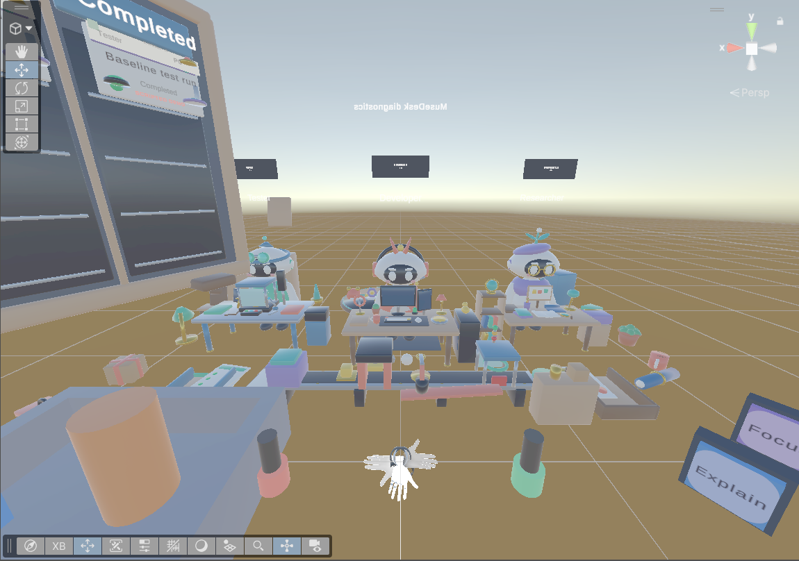
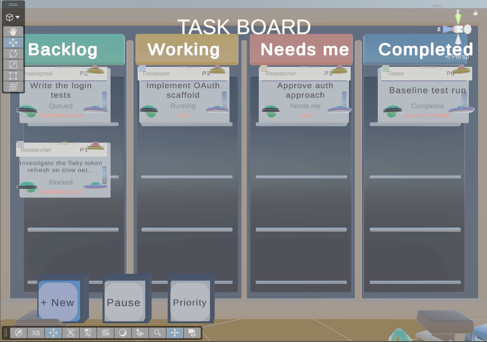
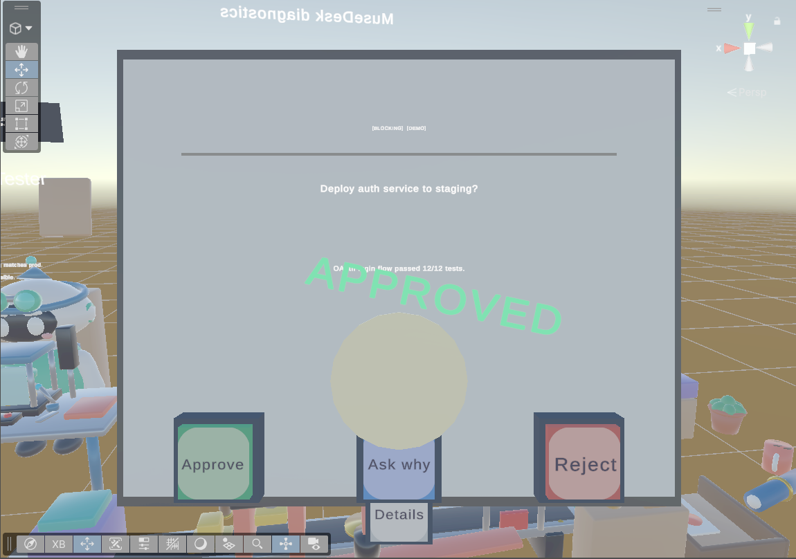
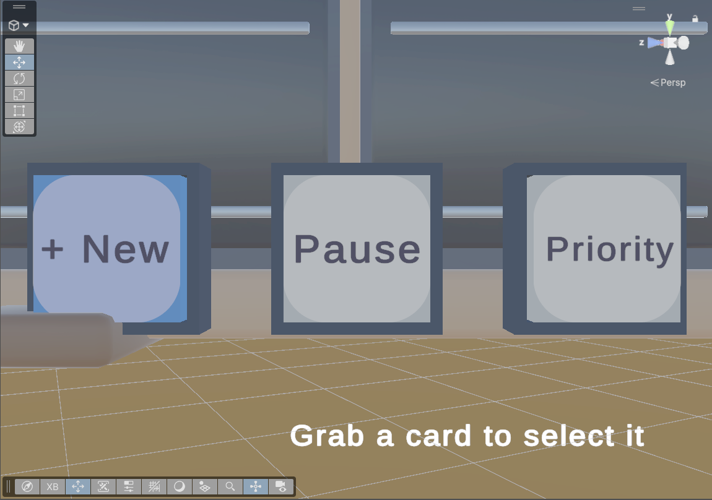
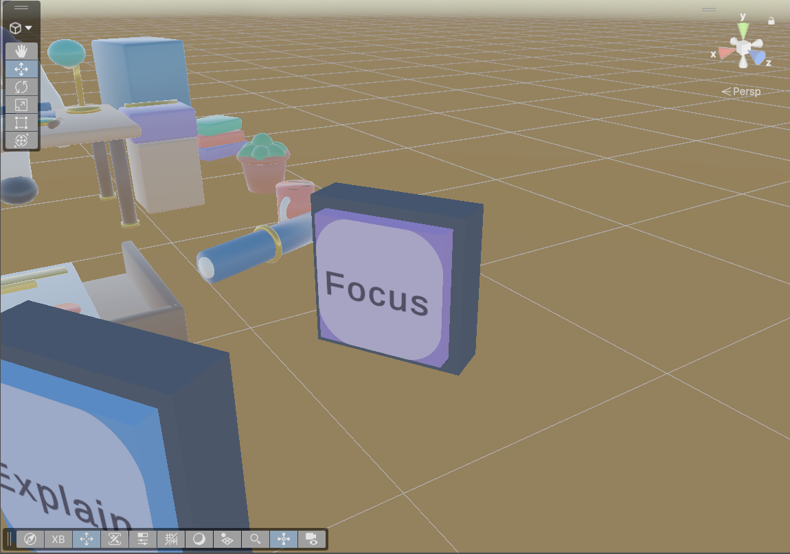

# MuseDesk: project summary for expert review

> **Superseded in part.** After this summary was reviewed, a further pass changed several things it describes (the task board now starts real work for one card type; the decision paper was rebuilt; the agents' state animation, described below as working, was found never to have played and was fixed). Current state: `docs/Engineering/FINAL_POLISH_CHANGELOG.md` and `FINAL_COMPETITION_READINESS.md`.

Written 2026-11-12. Purpose: give a reviewer who has never seen the project enough to say what we should work on next. Screenshots are in `docs/review_screenshots/` and referenced inline.

## 1. What it is

MuseDesk is a Meta Quest 3 mixed-reality app for supervising AI agents. Three small robot coworkers (Researcher, Developer, Tester) sit at miniature workstations in passthrough, about 60 cm in front of a seated user. They work on a task; when one needs a human decision it walks over and hands the user a physical paper. The user grabs it, reads it, and approves or rejects it by poking a button or pressing a rubber stamp on it. The backend then continues or stops the work.

The thesis is that the state of autonomous work should be spatial and calm: agents work quietly, and only a blocking decision physically comes to you.

Target: Meta VR Start Developer Competition 2026 (Productivity / Best Agentic Interaction). **Deadline 2026-11-18, noon Pacific.** Work started 2026-11-10. One developer plus AI coding agents.

Two hard rules the project is built around:

1. **Never present scripted activity as live work.** Every event and artifact carries `source_mode: live | demo`, and the app shows which mode it is in.
2. **The backend is the authority.** A local animation or button press is never proof that something was approved; the UI shows a confirmed outcome only after the backend acknowledges it.

Judges have no access to the developer's PC, so the APK must run a clearly labelled scripted demo on its own.

*Editor capture from the seated eye point (not a headset screenshot; passthrough replaces the brown ground). Agents face the user across their desks; the factory line is in front of them; the approve (green) and reject (red) stamps are nearest; the task board is on the left; Focus and Explain buttons on the right.*

## 2. Architecture

| Part | Technology | Size |
|---|---|---|
| Quest client | Unity 6000.6.8f1, URP 17.6, Meta XR SDK 209 (Interaction SDK hands, MR Utility Kit, passthrough), OpenXR, Vulkan, IL2CPP ARM64 | about 10,000 lines of C# in roughly 75 runtime scripts; one scene, `MainMRScene` |
| Backend | Python, FastAPI, SQLite, WebSocket event stream | about 3,700 lines, plus 1,800 lines of tests |
| Art | 61 FBX models generated by Blender scripts (characters with 39 animation clips each, workstations, factory, board, props) | |
| Tooling | 146 Editor "builder" scripts run through a Unity command-line pipeline; scene changes are scripted, not hand-edited | |

**Event flow.** The backend persists every event with a per-session sequence number and streams it over a WebSocket. The client has two interchangeable gateways behind one interface: a live gateway (REST + WebSocket to the PC over `adb reverse`) and a demo gateway that plays the same event shapes from a bundled fixture. Both feed one reducer, so the presentation layer is identical in both modes. Reconnect resumes from the last sequence number; duplicate events are ignored.

**Two API surfaces.** v1 is the session: agents, tasks, the approval decision, artifacts. v2 ("Phase 2") adds a task board (create, assign, pause, resume, priority), focus policy, diagrams and paged artifacts, with its own dense event stream and optimistic-concurrency revisions.

**Live mode does real work in a sandbox.** The tester really runs `pytest` in an isolated workspace directory; after approval the developer really writes an OAuth login scaffold and the tester really runs the new tests. Path escape, an allowlist and timeouts are enforced by a workspace guard. The researcher's recommendation, however, is a fixed string (see section 6).

## 3. What exists

### Interaction (hands only, no controllers)

- **Decision paper.** The Researcher carries a small blank paper to a hand-over spot. Grabbing it (pinch or whole hand) detaches it, reveals the content and scales it up. Buttons: Approve, Reject, Ask why, Details. The outcome mark (APPROVED / REJECTED) appears only when the backend confirms.
- **Physical stamps.** Two grabbable stamps on the desk. Pressing one onto the paper for 0.12 s sends the same approve or reject request as the buttons. They return to their rest spot when released.
- **Task board.** Four columns (Backlog, Working, Needs me, Completed). Cards are grabbable and can be dropped on an agent to assign. Three keys under the board: "+ New", "Pause", "Priority" (the last two act on the last-grabbed card). Each card shows pending / confirmed / rejected feedback from the backend.
- **Focus mode.** A desk key. While on, routine walk-ups are suppressed and updates collect in an inbox; blocking decisions still come through.
- **Pushable props.** Thirteen small desk objects (mug, plant, books, clock, toolbox, lamp and so on) are rigid bodies that the hand-tracking physics capsules can push and knock over. They tidy themselves back after four seconds. Desks and the factory are solid to them.
- **Agents.** Rigged characters with state-driven animation (idle, researching, typing, testing, waiting, success, error, walk, offer, give, receive). They lean away from a fingertip and spring back.

*Task board with sample cards. Each card: owner and priority in the header, a title that wraps to two lines then shrinks then truncates, state, and a LIVE or SCRIPTED DEMO label.*

*The decision paper, shown in the Editor with every element switched on at once (the APPROVED mark and the beige stamp target normally appear at different moments). Note the small, low-contrast body text.*

*Poke buttons are 3D keys: a housing fixed to the surface and a coloured cap that travels into it under the finger.*

### Visualisation driven by real events

- **Workstation monitors** show each agent's state and its own progress line from the backend.
- **Miniature software factory** plays a stage per real transition: blueprint print (researching), blueprint transfer (approved), assemble (coding), development complete, transport (artifact created), testing, test success (only if the artifact carried passing test counts), completed delivery, test failed, rejected return.
- **Testing station lamps** follow the tester's own run.
- **Completed-project shelf** gains a token only for a completion that references a produced artifact.
- **Agent handoffs**: Researcher walks to the Developer after an approval; Developer walks to the Tester when an artifact is created, carrying a token.

### Other

- Workspace placement: waits until the headset is worn, level and steady, then places the office in front of the user; re-places on headset re-mount or system recenter.
- Voice (optional build): Wit.ai transcription mapped to approve / reject / ask. Needs a token and network, so it cannot work in the standalone demo.
- Architecture diagram ("Explain" key), artifact viewer panel with paging, layout persistence.

## 4. What has been verified, and how

| Evidence | Result |
|---|---|
| Backend test suite | 110 passed |
| Live backend, real server process, driven over HTTP and WebSocket from the PC | 36 of 36 checks passed: tester runs real baseline tests (3 passed); nothing is built before the decision; approve produces a real change with 6 passing tests and a retrievable artifact; reject writes nothing and is reported as cancelled; replayed and conflicting responses handled; a second task is refused while one runs; another session's token is refused |
| Unity real-type checks (reducers, demo gateways, voice matching) | 54 of 54 passed |
| Unity compile | 0 errors |
| Scene health script | 2,600+ objects, 0 missing scripts, all poke buttons face the user |
| Quest 3 build | Builds, installs and launches (`com.musedesk.quest`) |
| On the headset, earlier sessions (2026-11-11) | Passthrough, hand tracking, paper grab and expand, live mode over USB were confirmed by the developer |
| On the headset, today | The device log recorded a physical stamp approval reaching the backend path. An SDK warning was being logged every frame and has been fixed |

**Not verified on the headset:** today's layout rearrangement, the handoff choreography fixes, the pushable props, the 3D keys, the card text layout, and frame rate. Editor captures prove static appearance only; they have misled us about interaction before.

## 5. What was repaired in the last pass (2026-11-12)

A full audit found and fixed, among others:

- The physical stamps drifted to a stale position; the task board could never go live (a session token was never stored).
- Rejecting a decision looked like success in the demo (shelf token, PASSED lamp, completion chime). A human approval lit the factory's "tests passed" gate.
- Two controllers fought over the Researcher after an approval, and the second handoff was silently dropped.
- A failed response left the paper stuck with no buttons and locked the stamps.
- The scene was laid out for the wrong side: stamps were 87 cm away behind the agents and the board was above the user's head.
- Button labels wrapped one letter per line, or were scaled to invisibility; card text overflowed the cards.
- Voice: "don't approve" approved.
- Backend: after a restart with a decision pending, the user was told their answer applied but nothing ran; sandboxed tests could read backend secrets; two runs could start in one session.

Full record: `docs/Engineering/REPAIR_AND_INTEGRATION_LOG.md`. Audit: `docs/Engineering/FULL_SYSTEM_AUDIT.md`.

## 6. Known gaps and weaknesses

Ordered by how much they undercut the product claim.

1. **The task board manages cards, not work.** Assigning a card to an agent changes the card; no agent starts doing it. The only real pipeline is the fixed "auth demo" run (research, decision, develop, test). So "delegate real tasks through a Kanban board" is not true yet.
2. **The Researcher does not research.** In live mode its recommendation is a hard-coded string labelled `live` (disclosed only through a provenance field). Developer and tester work is real. There is no LLM in the loop anywhere; a provider setting exists but is unused.
3. **No revision loop.** If tests fail, the run ends as failed. "Request changes" promises a revised proposal that never arrives.
4. **Only one kind of task** and one decision per run. Every decision is delivered by the Researcher.
5. **Performance is unmeasured.** Static review: about 520 separate renderers with no batching, foveated rendering off, all materials full PBR in a scene with no lights. Likely fine on triangles (50 to 75 thousand), unknown on draw calls.
6. **Hands still pass through most things.** Real hands cannot be stopped; today the small props react, agents lean, keys depress. The desks, the board and the characters' bodies do not react, and the rendered hand is not held at surfaces.
7. **Decision paper legibility.** Small text with weak contrast; the stamp target overlaps a button; one button hangs off the bottom edge.
8. **Standalone demo is thinner than live.** The artifact viewer never opens offline (no demo fixture for it), and the board is disconnected from the scripted session.
9. **Voice** has no on-character listening or speaking feedback and only works while a decision is pending.
10. **Process risk.** Most verification is automated or by Editor capture. On-head passes are short and infrequent, and that is where every serious interaction bug has been found.

Full list with severity: `docs/Engineering/REMAINING_ISSUES.md`.

## 7. Questions for the reviewer

We have six days. We would like a prioritised recommendation on:

1. **Depth versus breadth.** Is it better to make the one real pipeline excellent (a real LLM researcher, a real revise-and-retest loop, more than one task type), or to make the task board actually launch work so the "delegate anything" claim holds? Which matters more for a "Best Agentic Interaction" judgement?
2. **What should the standalone demo show**, given judges cannot run the backend? Is a scripted demo plus a recorded live session the right split, and how should the app make the difference legible without undermining the experience?
3. **Interaction design.** Is paper-plus-stamp the right hero interaction? What would make the hand-over, reading and stamping feel physically convincing on Quest hand tracking (poses, haptics substitutes, audio, hand-visual limiting at surfaces)?
4. **Layout and comfort.** Is a desk-scale diorama at 0.6 m with a side board and front stamps a sound seated layout? What would you change about reach, text size and gaze angles?
5. **Performance plan.** With 520 renderers and no measurements yet, what is the cheapest reliable path to a stable 72 Hz: mesh merging in the export, runtime static batching, GPU Resident Drawer, foveation? What should we measure first?
6. **Trust and honesty.** We label live versus demo on every card and paper. Is that enough? Should the hard-coded researcher be relabelled, replaced with a real model call, or removed from the live claim?
7. **What to cut.** Voice, the architecture diagram, layout persistence, the artifact panel and focus mode all exist at partial quality. Which are worth finishing and which should be removed before submission?

## 8. Where things are

| | |
|---|---|
| Scene | `Assets/MuseDesk/Scenes/MainMRScene.unity` |
| Client code | `Assets/MuseDesk/Scripts`, `Assets/MuseDesk/Phase2/Runtime` |
| Backend | `backend/app` (run and test instructions in `docs/Engineering/RUN_AND_DEPLOY.md`) |
| Contracts | `contracts/*.schema.json`, `docs/MuseDesk_Phase2_Agent_Pack/contracts` |
| Engineering record | `docs/Engineering/` (audit, repair log, test results, remaining issues, run and deploy) |
| Original specifications | `docs/musedesk_implementation_pack/`, `docs/MASTER_PHASE2_IMPLEMENTATION.md` |
| Build | `Builds/MuseDesk.apk` |
